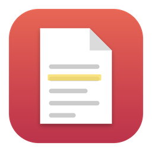

<div align="center">



# Plico

**Leggi, annota e riorganizza i tuoi PDF.**
Un lettore ed editor di PDF leggero, per Mac e Windows.

</div>

<p align="center">
  <a href="https://plico-silk.vercel.app"><strong>Sito</strong></a> ·
  <a href="https://github.com/mattiadelia001-byte/Plico/releases/latest/download/Plico-mac.dmg">Scarica per Mac</a> ·
  <a href="https://github.com/mattiadelia001-byte/Plico/releases/latest/download/Plico-windows-setup.exe">Scarica per Windows</a> ·
  <a href="https://github.com/mattiadelia001-byte/Plico/releases">Tutte le versioni</a>
</p>

---

Plico è un'app per lavorare sui PDF senza complicazioni: li apri, li leggi, ci scrivi sopra, ne unisci o
dividi le pagine e li rendi più leggeri. Tutto avviene sul tuo computer: i file non vengono caricati da
nessuna parte.

## Cosa sa fare

**Leggere**
- Schede per tenere aperti più PDF insieme
- Miniature delle pagine, indice del documento, zoom
- Ricerca nel testo (senza distinguere maiuscole e accenti)
- Tema chiaro e scuro

**Annotare** (le annotazioni sono vere, restano nel PDF e si vedono anche in altri lettori)
- Evidenzia, sottolinea, barra
- Testo, note, forme, frecce, disegno a mano libera
- Firma
- Annulla e ripristina senza limiti

**Organizzare**
- Riordina le pagine trascinando le miniature
- Ruota, elimina, duplica, inserisci, estrai pagine
- Ritaglia le pagine
- Crea un nuovo documento da zero

**Strumenti**
- **Unisci** più PDF in uno
- **Dividi** un PDF in più file
- **Comprimi** un PDF pesante: ricodifica le immagini, mentre il testo resta selezionabile e ricercabile
- **Proteggi** una copia con password (cifratura AES-256)
- **Esporta** le pagine come immagini
- Proprietà del documento e stampa

## Come si usa

Apri un PDF dal pulsante **Apri**, oppure trascinalo nella finestra. Dalla schermata iniziale puoi anche
unire o comprimere dei PDF senza aprirne nessuno prima.

Le scorciatoie seguono le abitudini di sempre (`⌘` su Mac, `Ctrl` su Windows):

| Azione | Scorciatoia |
| --- | --- |
| Apri / Nuovo | `⌘O` / `⌘N` |
| Salva / Salva con nome | `⌘S` / `⌘⇧S` |
| Annulla / Ripristina | `⌘Z` / `⌘⇧Z` |
| Ruota a sinistra / a destra | `⌘L` / `⌘R` |
| Unisci PDF | `⌘⇧M` |
| Stampa | `⌘P` |
| Proprietà documento | `⌘I` |
| Chiudi scheda | `⌘W` |

## Compilare Plico

Plico è fatto con [Tauri](https://tauri.app) (guscio nativo in Rust), React + TypeScript per l'interfaccia e
[MuPDF](https://mupdf.com) (in WebAssembly) come motore PDF.

Servono [Node](https://nodejs.org) 20 o più recente e [Rust](https://rustup.rs). Su Windows servono anche gli
"Strumenti di compilazione C++" di Visual Studio e WebView2 (già presente in Windows 10 e 11).

```sh
npm install
npm run tauri dev        # app nativa con ricarica automatica
npm run dev              # solo l'interfaccia nel browser (http://localhost:1420)
```

Per creare l'app:

```sh
npm run build:mac        # Mac: crea Plico.app
npm run tauri build      # Windows: crea l'installer .exe e .msi
```

Su Mac l'app si trova in `src-tauri/target.noindex/release/bundle/macos/Plico.app`; su Windows gli installer
sono in `src-tauri/target.noindex/release/bundle/nsis` e `.../msi`.

Non hai un PC Windows? Su GitHub, in **Actions → Compila Plico**, parte una compilazione automatica che
produce l'installer per Windows e l'app per Mac.

## Cose da sapere

- **macOS.** L'app non è firmata con un certificato Apple. Sul Mac che l'ha compilata si apre normalmente;
  su un altro Mac, se compare "app danneggiata", apri il Terminale ed esegui
  `xattr -cr /percorso/di/Plico.app`.
- **Windows.** La versione per Windows viene compilata dal flusso di GitHub ma non è ancora stata provata su
  un computer vero: se la usi e trovi un problema, segnalalo nelle *Issues*.

## Licenza

Plico usa MuPDF, distribuito con licenza **[AGPL-3.0](https://www.gnu.org/licenses/agpl-3.0.html)**. Se
distribuisci Plico ad altri, anche gratis, devi rendere disponibile il codice sorgente dell'app, oppure
acquistare una licenza commerciale da [Artifex](https://artifex.com).
